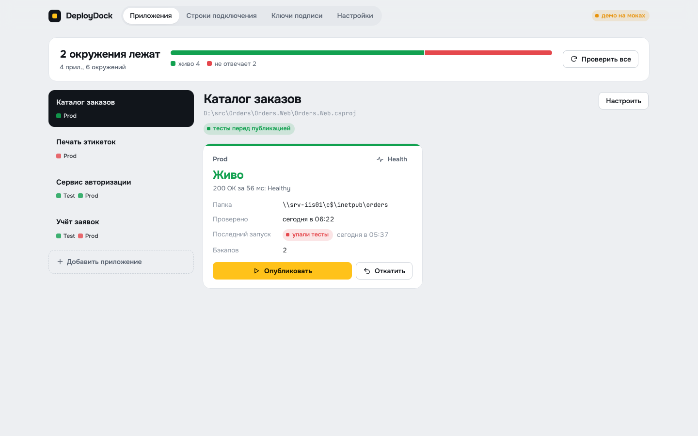
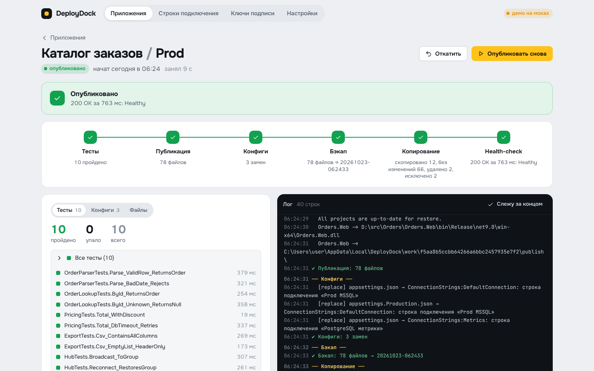

# DeployDock

Десктоп-приложение для публикации .NET 9 приложений на IIS. Одна кнопка вместо ручного «`dotnet publish` → перетащить папку → поправить appsettings → проверить, что поднялось».



## Что делает

Для каждого приложения и окружения (Test, Prod, …) запуск идёт по этапам:

1. **Тесты.** `dotnet test` с TRX-отчётом. Упал хоть один — публикации нет, сервер не трогается, в интерфейсе видно какой тест и почему.
2. **Публикация.** `dotnet publish -c Release` во временную папку.
3. **Конфиги.** В `appsettings*.json` публикации подставляются строки подключения из справочника. Исходники не трогаются. Пишется и в `appsettings.json`, и в `appsettings.{Env}.json`, если там есть этот ключ, иначе окруженческий файл перебил бы значение.
4. **Ключи подписи.** Если значение по указанному пути (например `Jwt:Key`) начинается на `dev` в любом регистре, оно заменяется ключом окружения. Ключ генерируется один раз и дальше всегда тот же, поэтому токены не слетают при каждом деплое.
5. **Бэкап.** Текущая версия на сервере копируется в бэкап, хранится N последних.
6. **Копирование.** Кладётся `app_offline.htm`, чтобы IIS отпустил dll, потом папка на сервере становится зеркалом публикации: новое копируется, лишнее удаляется. Исключения (`logs`, `uploads`, `*.log`…) не удаляются и не перезаписываются.
7. **Health-check.** Опрос `api/health` до ответа 2xx или таймаута. Не поднялось — красный статус и кнопка «Откатить».

Ещё есть живой лог через SignalR, дашборд с health всех окружений (опрос раз в минуту), генератор случайных ключей и откат на любой из сохранённых бэкапов.



## Установка

Нужен Windows и .NET 9 (SDK или ASP.NET Core Runtime; SDK всё равно нужен для сборки публикуемых проектов).

1. Скачай `DeployDock-2.0.0-win-x64.zip` из [Releases](../../releases) и распакуй куда угодно, например `D:\Tools\DeployDock`.
2. Запусти `DeployDock.exe`. Откроется обычное окно, без консоли и браузера.
3. Закрыл окно — всё остановлено, сервер внутри завершается вместе с ним.

Внутри окна работает тот же ASP.NET-сервер, Electron просто запускает его скрыто на свободном порту `127.0.0.1` и показывает интерфейс. Наружу ничего не слушает, авторизации нет: рассчитано на одного пользователя на своей машине.

## Данные и перенос

Всё лежит в папке `data` рядом с `DeployDock.exe`:

| Что | Где |
|---|---|
| Приложения, окружения, справочник строк, ключи подписи | `data\deploydock.db` (SQLite, один файл) |
| Ключ шифрования строк подключения и ключей подписи | `data\deploydock.key` |
| Бэкапы для отката | `data\backups\` |
| Логи | `data\logs\` |

Перенести на другой ПК или обновить версию: скопируй `deploydock.db` и `deploydock.key` в папку `data` новой копии. Без `.key` строки подключения и ключи подписи не расшифруются, остальное откроется.

Секреты зашифрованы AES-256-GCM ключом из `deploydock.key`. Кто получил папку `data` целиком, тот прочитает и строки подключения, поэтому храни её так же, как хранил бы сами строки.

Переход с 1.x: при первом запуске база и бэкапы из `%LOCALAPPDATA%\DeployDock` подхватятся сами и перешифруются новым ключом. Работает на том же ПК под той же учёткой, потому что старая версия шифровала через DPAPI.

## Исключения

По одному на строку, пути относительно папки на сервере:

```
logs          папка целиком
web.config    файл
*.log         маска по имени на любой глубине
uploads/*     маска с путём
```

Не добавляй `web.config` в исключения до первого деплоя: он не скопируется, и IIS не поднимет приложение.

## Разработка

```
server/    ASP.NET Core 9, minimal API, EF Core + SQLite, SignalR
web/       React 19 + Vite + TypeScript
desktop/   Electron-оболочка: окно, скрытый запуск сервера, нативные диалоги выбора папок
```

```bash
# фронт в wwwroot сервера
cd web && npm ci && npm run build

# сервер отдельно (откроется в браузере)
cd server && dotnet run

# десктоп в режиме разработки (берёт server/bin/Release/net9.0/DeployDock.dll)
cd server && dotnet build -c Release && cp -r wwwroot bin/Release/net9.0/
cd desktop && npm ci && npm start

# демо на моках, без сервера: один HTML-файл в web/dist-mock
cd web && npm run build:mock

# сборка под Windows (можно на Linux, Wine не нужен)
cd server && dotnet publish -c Release -r win-x64 --self-contained false \
  -p:PublishSingleFile=true -p:IncludeNativeLibrariesForSelfExtract=true \
  -p:AssemblyName=DeployDock.Server -o ../desktop/build/backend
cd desktop && npm run dist     # → desktop/build/out/DeployDock-win32-x64
```

Схема базы создаётся через `EnsureCreated`, миграций нет. Если меняешь сущности — добавь миграции, иначе старые базы не откроются.

## Лицензия

[MIT](LICENSE)
